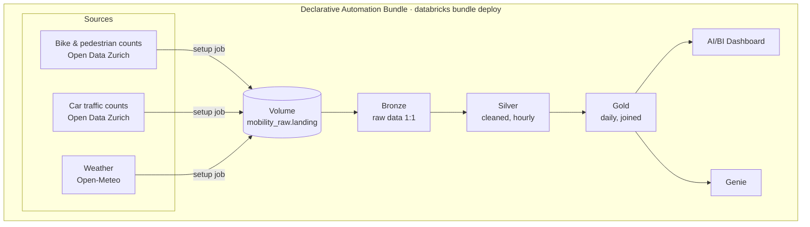

# Databricks Workshop: Data for Sustainable Mobility

A hands-on introduction to **Databricks** for the BSc module *Sustainable Mobility*.
You set up a complete Databricks environment **as code** with a **Declarative Automation Bundle (DAB)**,
practise the basics with small exercises, and then build a project step by step: combining
**bike, pedestrian and car traffic counts of the City of Zurich (2009–2026, ~40 million rows)** with
**weather data** – from raw files to a shared **AI/BI dashboard**.



## Learning goals

After the workshop you can …

- find your way around a Databricks workspace (notebooks, Unity Catalog, volumes, jobs, pipelines, dashboards, Genie)
- set up a Databricks environment **reproducibly as code** (`databricks bundle deploy`)
- read, clean, join and aggregate data with **SQL** and **Python (PySpark)**
- explain and apply the **medallion architecture** (bronze → silver → gold)
- build and publish an **AI/BI dashboard** and ask questions with **Genie**
- interpret mobility data critically (data quality, correlation vs. causation)

## Contents

1. **Setup** – [Quickstart](#quickstart--everything-in-the-browser) below
2. **Getting started** – [src/01_getting_started](src/01_getting_started)
3. **Basic exercises** – [src/02_exercises](src/02_exercises) (see table below)
4. **Project "Bike vs. car in Zurich"** – [step-by-step guide](src/03_project/README.md)
5. **Bonus: NYC taxi** – [src/04_bonus](src/04_bonus)
6. **MZMV** – [in class: one file from upload to silver; at home: load all tables](src/05_mzmv/README.md)
7. **Live flight tracking (local, LV06)** – [live-flight-tracking-local](live-flight-tracking-local/README.md): your own pipeline from live aircraft data to a map – on your laptop with marimo and DuckDB, no Databricks
8. **Clean up** – [start over or remove everything](#clean-up)

Every task comes with collapsible **hints** and the **solution** right below your code cell – try it yourself first!

## Quickstart – everything in the browser

No local installation needed – you only need a browser.

1. **Create a free account:** [Databricks Free Edition](https://www.databricks.com/learn/free-edition) → *Sign up*.
2. **Get the repo into your workspace:** **Workspace** → **Home** → **Create** → **Git folder** →
   paste `https://github.com/LucerneUniversityOfAppliedScience/eds_vseni05_hs26.git` → **Create Git folder**.
3. **Deploy the bundle:** in the new folder `eds_vseni05_hs26` open the **Deployments** panel (🚀 icon on the left) →
   target `prod` → **Deploy**. This creates the schemas, the volume and the jobs.
4. **Load the data:** in the same panel, next to the job `01_workshop_setup`, click **Run** (▶︎).
   It downloads the data (≈ 100 MB) into your volume and takes about 5 minutes
   (progress: **Jobs & Pipelines** → `01_workshop_setup`).
5. **Start:** open `src/01_getting_started/01_databricks_basics` in the Git folder and attach it to **Serverless**.

**Problems?**

| Problem | Solution |
|---|---|
| Job waits with "There are already 1 active runs" | Free Edition runs jobs one after the other – wait until the other one has finished |
| `RESOURCE_EXHAUSTED: You have hit your limit for serverless compute` | the Free Edition compute quota is reached – try again later (it resets the next day at the latest) |
| A notebook does not find a table | did the setup job finish successfully? did you run the previous step? |

## What the bundle creates

| Object | Name | Purpose |
|---|---|---|
| Schemas | `workspace.mobility_raw` / `_bronze` / `_silver` / `_gold` | project layers |
| Volume | `workspace.mobility_raw.landing` | all raw files |
| Schemas | `workspace.exercises`, `workspace.adventureworks` | basic exercises |
| Catalog | `mzmv` with schemas `raw` (+ volumes `landing`, `files`), `bronze`, `silver`, `gold` | for the MZMV (Mikrozensus Mobilität und Verkehr) part – created by the setup job |
| Job | `01_workshop_setup` | creates `mzmv`, downloads the data, loads AdventureWorks |
| Job | `02_mzmv_load` | unzips your uploaded MZMV ZIP and loads the SAS files as bronze tables |
| Job | `99_workshop_cleanup` | removes all data again – only with `confirm=yes` |

**MZMV:** in class you upload one file and follow `src/05_mzmv/00_class_example_one_file`. At home you upload
`MZMV_workshop.zip` to `mzmv.raw.landing` and run `02_mzmv_load` (≈ 30 min) – see the [MZMV guide](src/05_mzmv/README.md).

## Clean up

**Start over (delete all data):**

1. *Jobs & Pipelines* → `99_workshop_cleanup` → ▾ next to *Run now* → **Run now with different parameters**.
2. Set the parameter `confirm` to `yes` → **Run**. (Without `yes` the job stops and deletes nothing.)

This deletes the catalog `mzmv` (incl. your uploaded MZMV ZIP), all tables in the workshop schemas and all files in the
volume. Schemas, volume, jobs and dashboard stay – run `01_workshop_setup` again to start fresh.

**Workspace not empty?** If your workspace already contains schemas, tables, jobs or dashboards from earlier courses,
open `src/00_setup/98_nuke_workspace` **in your Git folder** and run it: first as a dry run (it only lists what it would
delete), then with `mode` = `delete` and `confirm` = `NUKE`. It deletes all your catalogs, schemas, tables, volumes,
jobs, pipelines, dashboards and Genie spaces – your Git folders and notebooks stay. Then deploy and run `01_workshop_setup`.

**Remove everything (at the end of the course):** first run the cleanup above, then open the **Deployments** panel in
your Git folder and click **Destroy**. This removes the schemas, the volume, the jobs, the pipeline and the dashboard.
Finally you can delete the Git folder itself.

## Repository structure

```
.
├── databricks.yml                 # bundle definition (variables, target)
├── resources/                     # what the bundle creates in the workspace
│   ├── unity_catalog.yml          #   schemas + volume
│   ├── setup_data.job.yml         #   job: create mzmv, download data, load AdventureWorks
│   ├── mzmv_load.job.yml          #   job: unzip the MZMV ZIP, load SAS files as bronze tables
│   └── cleanup.job.yml            #   job: delete all workshop data (manual)
├── src/
│   ├── 00_setup/                  # notebooks used by the setup and cleanup jobs
│   ├── 01_getting_started/        # first steps: workspace, Unity Catalog, Delta
│   ├── 02_exercises/              # basic exercises e01–e08 (SQL, PySpark, file formats, window functions)
│   ├── 03_project/                # project: step-by-step guide (README) + notebooks step_1 … step_5
│   ├── 04_bonus/                  # NYC taxi
│   └── 05_mzmv/                   # Mobility and Transport Microcensus: class example, load job notebooks, silver exercise
├── live-flight-tracking-local/    # LV06, runs on your laptop: marimo notebooks (exercises + solutions), DuckDB, map app
├── data/                          # README only – the data is published as GitHub release asset
├── cheatsheets/                   # Python, pandas, PySpark, Matplotlib, … cheat sheets (PDF)
```

## Basic exercises

| # | Exercise | Topics | Data |
|---|---|---|---|
| e01 | [SQL basics with AdventureWorks](src/02_exercises/e01_sql_basics_adventureworks.sql) | 55 SQL tasks: SELECT, data types, NULL, sorting, DISTINCT, WHERE, JOINs, functions & aggregates, subqueries, CTEs, window functions | AdventureWorks |
| e02 | [PySpark: Basel population](src/02_exercises/e02_pyspark_basel_population.py) | read Parquet, schemas, Delta tables, SQL queries | Open Data Basel |
| e03 | [File formats: JSON](src/02_exercises/e03_file_format_json.py) | nested JSON → bronze/silver | travel offers |
| e04 | [File formats: XML](src/02_exercises/e04_file_format_xml.py) | XML → bronze/silver | countries |
| e05 | [File formats: Excel](src/02_exercises/e05_file_format_xlsx.py) | XLSX with pandas → Spark → Delta | financial sample |
| e06 | [PySpark transformations: bike rental](src/02_exercises/e06_pyspark_transformations_bike_rental.py) | NULL handling, date/time, `when/otherwise`, strings, regex | synthetic bike rentals |
| e07 | [Window functions: bike rental](src/02_exercises/e07_window_functions_bike_rental.py) | ranking, running totals, `lag`, rolling windows, pivot | synthetic bike rentals |
| e08 | [Window functions: Zurich traffic counts](src/02_exercises/e08_window_functions_traffic_counts.py) | window functions, pivot/unpivot on real counts | Open Data Zurich |

## Data sources

| Dataset | Source | License |
|---------|--------|--------|
| Automatic pedestrian and bike counts, 15-minute values, 2009–2026 | [Open Data City of Zurich](https://data.stadt-zuerich.ch/dataset/ted_taz_verkehrszaehlungen_werte_fussgaenger_velo) | CC0 |
| Locations of the automatic pedestrian and bike counting stations | [Open Data City of Zurich](https://data.stadt-zuerich.ch/dataset/geo_standorte_der_automatischen_fuss__und_velozaehlungen) | CC0 |
| Motorized traffic counts, hourly values, 2012–2026 | [Open Data City of Zurich](https://data.stadt-zuerich.ch/dataset/sid_dav_verkehrszaehlung_miv_od2031) | CC0 |
| Hourly weather Zurich, 2009–2026 | [Open-Meteo Historical Weather API](https://open-meteo.com/en/docs/historical-weather-api) | CC BY 4.0 |
| AdventureWorks | Microsoft sample database | Microsoft sample data |
| NYC Yellow Taxi Trips (bonus) | Databricks sample data `samples.nyctaxi.trips` | – |

Details: [data/README.md](data/README.md).

## Further reading

- [Databricks Free Edition](https://www.databricks.com/learn/free-edition)
- [Declarative Automation Bundles](https://docs.databricks.com/dev-tools/bundles/)
- [Lakeflow Spark Declarative Pipelines](https://docs.databricks.com/ldp)
- [AI/BI Dashboards](https://docs.databricks.com/dashboards/) and [Genie](https://docs.databricks.com/genie/)
- [Medallion architecture](https://docs.databricks.com/lakehouse/medallion.html)
