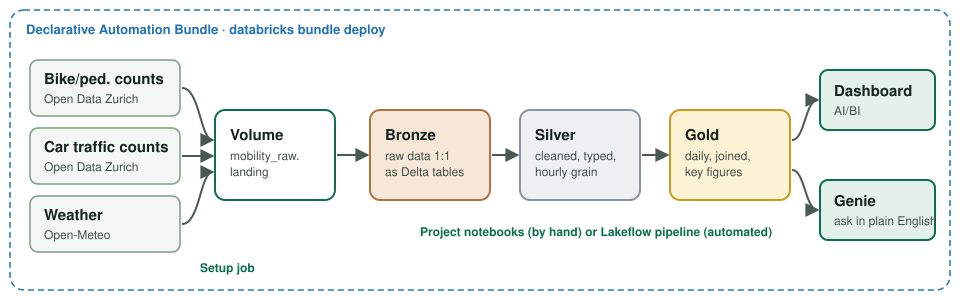

# Databricks Workshop: Data for Sustainable Mobility

A hands-on introduction to **Databricks** for the BSc module *Sustainable Mobility*.
You set up a complete Databricks environment **as code** with a **Declarative Automation Bundle (DAB)**,
practise the basics with small exercises, and then build a project step by step: combining
**bike, pedestrian and car traffic counts of the City of Zurich (2009–2026, ~40 million rows)** with
**weather data** – from raw files to a shared **AI/BI dashboard**.



## Learning goals

After the workshop you can …

- find your way around a Databricks workspace (notebooks, Unity Catalog, volumes, jobs, pipelines, dashboards, Genie)
- set up a Databricks environment **reproducibly as code** (`databricks bundle deploy`)
- read, clean, join and aggregate data with **SQL** and **Python (PySpark)**
- explain and apply the **medallion architecture** (bronze → silver → gold)
- build and publish an **AI/BI dashboard** and ask questions with **Genie**
- interpret mobility data critically (data quality, correlation vs. causation)

## Agenda (suggestion)

| # | Part | Time | Material |
|---|------|------|----------|
| 0 | Intro: what is Databricks / a lakehouse? | 15' | slides |
| 1 | **Setup**: Free Edition, CLI, deploy the bundle, load the data | 30' | [docs/01_setup_free_edition.md](docs/01_setup_free_edition.md), [docs/02_declarative_automation_bundles.md](docs/02_declarative_automation_bundles.md) |
| 2 | **Getting started**: workspace, Unity Catalog, first data, Delta time travel | 45' | [src/01_getting_started](src/01_getting_started) |
| 3 | **Basic exercises** (pick what suits you) | 60'+ | [src/02_exercises](src/02_exercises) |
| 4 | **Project** "Bike vs. car in Zurich" – step by step to the dashboard | 3–4 h | [src/03_project/README.md](src/03_project/README.md) |
| + | Bonus: NYC taxi – which trips could a bike replace? | 20' | [src/04_bonus](src/04_bonus) |
| 5 | **MZMV**: upload the Mobility and Transport Microcensus and load it as bronze tables | 30' | [src/05_mzmv/README.md](src/05_mzmv/README.md) |

Solutions are published on **Thursday**.

## Quickstart

```bash
# 1. Clone the repo
git clone https://github.com/LucerneUniversityOfAppliedScience/eds_vseni05_hs26.git
cd eds_vseni05_hs26

# 2. Connect to your Free Edition workspace (browser login) – replace the URL with yours
databricks auth login --host https://dbc-xxxxxxxx-xxxx.cloud.databricks.com --profile workshop

# 3. Validate and deploy the bundle (schemas, volume, jobs)
databricks bundle validate --profile workshop
databricks bundle deploy   --profile workshop

# 4. Load the data (downloads ~100 MB from the GitHub release into your volume, ~3 min)
databricks bundle run setup_data --profile workshop
```

Then open your workspace → **Workspace → Home → mobility_workshop → files → src** and start with
`01_getting_started/01_databricks_basics`.

No terminal? See **Option B (browser only)** in [docs/02_declarative_automation_bundles.md](docs/02_declarative_automation_bundles.md).

## What the bundle creates

| Object | Name | Purpose |
|---|---|---|
| Schemas | `workspace.mobility_raw` / `_bronze` / `_silver` / `_gold` | project layers |
| Volume | `workspace.mobility_raw.landing` | all raw files |
| Schemas | `workspace.exercises`, `workspace.adventureworks` | basic exercises |
| Catalog | `mzmv` with schemas `raw` (+ volumes `landing`, `files`), `bronze`, `silver`, `gold` | for the MZMV (Mikrozensus Mobilität und Verkehr) part – created by the setup job |
| Job | `workshop_setup` | creates `mzmv`, downloads the data, loads AdventureWorks |
| Job | `mzmv_load` | unzips your uploaded MZMV ZIP and loads the SAS files as bronze tables |
| Job | `workshop_cleanup` | removes all data again – only with `confirm=yes` |

```bash
# Reset everything (data only – schemas, volume and jobs stay):
databricks bundle run cleanup --params confirm=yes --profile workshop
# Remove the bundle resources as well:
databricks bundle destroy --profile workshop
```

## Repository structure

```
.
├── databricks.yml                 # bundle definition (variables, target)
├── resources/                     # what the bundle creates in the workspace
│   ├── unity_catalog.yml          #   schemas + volume
│   ├── setup_data.job.yml         #   job: create mzmv, download data, load AdventureWorks
│   ├── mzmv_load.job.yml          #   job: unzip the MZMV ZIP, load SAS files as bronze tables
│   └── cleanup.job.yml            #   job: delete all workshop data (manual)
├── src/
│   ├── 00_setup/                  # notebooks used by the setup and cleanup jobs
│   ├── 01_getting_started/        # first steps: workspace, Unity Catalog, Delta
│   ├── 02_exercises/              # basic exercises e01–e08 (SQL, PySpark, file formats, window functions)
│   ├── 03_project/                # project: step-by-step guide (README) + notebooks step_1 … step_5
│   ├── 04_bonus/                  # NYC taxi
│   └── 05_mzmv/                   # Mobility and Transport Microcensus: upload guide + load notebooks
├── data/                          # README only – the data is published as GitHub release asset
├── cheatsheets/                   # Python, pandas, PySpark, Matplotlib, … cheat sheets (PDF)
└── docs/                          # setup guides and instructor notes
```

## Basic exercises

| # | Exercise | Topics | Data |
|---|---|---|---|
| e01 | [SQL basics with AdventureWorks](src/02_exercises/e01_sql_basics_adventureworks.sql) | 55 SQL tasks: SELECT, data types, NULL, sorting, DISTINCT, WHERE, JOINs, functions & aggregates, subqueries, CTEs, window functions | AdventureWorks |
| e02 | [PySpark: Basel population](src/02_exercises/e02_pyspark_basel_population.py) | read Parquet, schemas, Delta tables, SQL queries | Open Data Basel |
| e03 | [File formats: JSON](src/02_exercises/e03_file_format_json.py) | nested JSON → bronze/silver | travel offers |
| e04 | [File formats: XML](src/02_exercises/e04_file_format_xml.py) | XML → bronze/silver | countries |
| e05 | [File formats: Excel](src/02_exercises/e05_file_format_xlsx.py) | XLSX with pandas → Spark → Delta | financial sample |
| e06 | [PySpark transformations: bike rental](src/02_exercises/e06_pyspark_transformations_bike_rental.py) | NULL handling, date/time, `when/otherwise`, strings, regex | synthetic bike rentals |
| e07 | [Window functions: bike rental](src/02_exercises/e07_window_functions_bike_rental.py) | ranking, running totals, `lag`, rolling windows, pivot | synthetic bike rentals |
| e08 | [Window functions: Zurich traffic counts](src/02_exercises/e08_window_functions_traffic_counts.py) | window functions, pivot/unpivot on real counts | Open Data Zurich |

## Data sources

| Dataset | Source | License |
|---------|--------|--------|
| Automatic pedestrian and bike counts, 15-minute values, 2009–2026 | [Open Data City of Zurich](https://data.stadt-zuerich.ch/dataset/ted_taz_verkehrszaehlungen_werte_fussgaenger_velo) | CC0 |
| Locations of the automatic pedestrian and bike counting stations | [Open Data City of Zurich](https://data.stadt-zuerich.ch/dataset/geo_standorte_der_automatischen_fuss__und_velozaehlungen) | CC0 |
| Motorized traffic counts, hourly values, 2012–2026 | [Open Data City of Zurich](https://data.stadt-zuerich.ch/dataset/sid_dav_verkehrszaehlung_miv_od2031) | CC0 |
| Hourly weather Zurich, 2009–2026 | [Open-Meteo Historical Weather API](https://open-meteo.com/en/docs/historical-weather-api) | CC BY 4.0 |
| AdventureWorks | Microsoft sample database | Microsoft sample data |
| NYC Yellow Taxi Trips (bonus) | Databricks sample data `samples.nyctaxi.trips` | – |

Details: [data/README.md](data/README.md).

## For instructors

Preparation checklist, reference results and common pitfalls: [docs/00_instructors.md](docs/00_instructors.md)

## Further reading

- [Databricks Free Edition](https://www.databricks.com/learn/free-edition)
- [Declarative Automation Bundles](https://docs.databricks.com/dev-tools/bundles/)
- [Lakeflow Spark Declarative Pipelines](https://docs.databricks.com/ldp)
- [AI/BI Dashboards](https://docs.databricks.com/dashboards/) and [Genie](https://docs.databricks.com/genie/)
- [Medallion architecture](https://docs.databricks.com/lakehouse/medallion.html)
