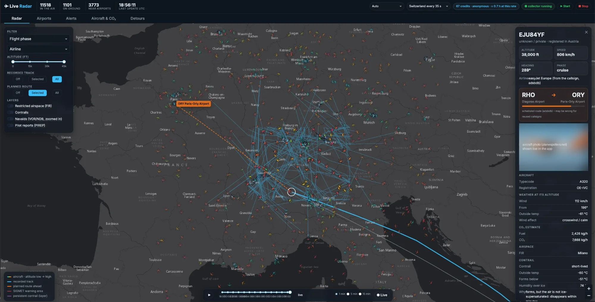

# ✈ Live flight tracking on your laptop



You build your own data pipeline for live aircraft positions: from a single API call to a database with
**bronze, silver and gold** layers, analyses on CO₂, weather, noise and train alternatives – and at the end the
map above. Everything runs on your laptop: [marimo](https://marimo.io) notebooks, one [DuckDB](https://duckdb.org)
file, no cloud account.

---

## 1 · Setup (once, 5 minutes)

You need [uv](https://docs.astral.sh/uv/getting-started/installation/) – it installs Python and all packages.

```bash
git clone https://github.com/LucerneUniversityOfAppliedScience/eds_vseni05_hs26.git   # or: git pull
cd eds_vseni05_hs26/live-flight-tracking-local
uv sync                         # Python + all packages into .venv
cp .env.template .env           # then fill in the R2 keys from the slides
uv run marimo edit .            # opens the browser
```

In the browser, open **`tools/00_setup.py`** and press the **run button at the bottom right**. Every line should
turn green.

> marimo does not run a notebook when you open it – press the run button once in every notebook.

---

## 2 · The notebooks

Work in `exercises/`. Every gap is marked **TODO**, has a hint to fold out and a check below it: ❌ red until it is
right, then ✅ green. Stuck? The same file in `solutions/` has the answer.

| | Notebook | You learn |
|---|---|---|
| **Pipeline** | 01 First message | one API call, what a state vector is |
| | 02 Bronze | store raw data in DuckDB – without duplicates |
| | 03 Collector | a loop that runs for hours: credits, errors, rhythm |
| | 04 Backfill | load the class history from the bucket and merge it |
| | 05 Silver | clean data, airline names and aircraft categories – and the watermark trap |
| | 06 Gold | airports, current positions, approaches |
| **Analyses** | 07 Routes & detours | how far aircraft really fly |
| | 08 CO₂ | fuel and CO₂ per aircraft type and airline |
| | 09 Weather & contrails | wind and contrails at flight level |
| | 10 Analyses | night flights, top routes, fleet age, the Skyguide outage |
| **Deeper** | 11 Plane or train | CO₂ per person, travel time by train |
| | 12 Who is overflown | municipalities, residents, noise contours |
| | 13 Ground weather | MeteoSwiss station Kloten vs. traffic |
| | 14 EUROCONTROL | your counts vs. the official numbers |
| | 15 Holidays | do school holidays fill the airport? |
| | 16 pycontrails | contrail models on a grid over Switzerland |
| | 17 Disruptions | find outages automatically |
| | 18 Holdings & go-arounds | what arriving aircraft do |
| | 19 Runways & wind | which runway, and why |
| **Finish** | 20 Dashboard | turn a notebook into an app with `marimo run` |

**Before notebook 07: load the real data once.** 01–06 practise in their own small files; 07–20 analyse
`flights.duckdb`. Either open `tools/88_start_everything.py` and press **Start**, or run in a terminal:

```bash
uv run collector.py --backfill-hours 24 --no-live
```

Without it, notebook 07 stops with the message *No flight data in flights.duckdb yet*.

Notebook 16 needs one extra package: `uv sync --group contrails`.

---

## 3 · Start everything (just the map)

Open **`tools/88_start_everything.py`**, choose the hours of history, press **Start**, click the link. Or in a terminal:

```bash
uv run start.py
```

The map collects Switzerland live, shows the whole world from the class bucket, and has a time slider to replay
the past hours. It keeps running while you work in the notebooks – stop it with **Stop** (or Ctrl+C).

---

## 4 · When something goes wrong

| You see | What to do |
|---|---|
| `No flight data in flights.duckdb yet` | Load the real data once (see *Before notebook 07* above), then rerun the notebook. |
| `Could not set lock on file "flights.duckdb"` | The app or `collector.py` is running and owns the file. Notebooks 07–20 work on a copy, so this only hits scripts. |
| `429 Too Many Requests` | No OpenSky credits left: anonymously your IP address gets 400 a day, and a classroom often shares one address. Use the backfill (04) instead. |
| Backfill finds no files | The R2 keys in `.env` are missing or mistyped – `tools/00_setup.py` shows which. |
| A notebook shows code but no results | Press the run button at the bottom right. |
| The map page does not open | Another program uses the port – `start.py` picks the next free one and prints it. |

---

## 5 · At the end

Open **`tools/99_cleanup.py`**: it shows what the workshop left on your laptop (databases, downloads, your keys in
`.env`) and deletes what you tick. Or simply delete the whole folder.

---

<sub>Data: [OpenSky Network](https://opensky-network.org) · weather [Open-Meteo](https://open-meteo.com) (CC BY 4.0),
[MeteoSwiss](https://www.meteoswiss.admin.ch) · airports [OurAirports](https://ourairports.com) · routes
[adsbdb](https://www.adsbdb.com) · photos [planespotters.net](https://www.planespotters.net) · each notebook names
its sources.</sub>
